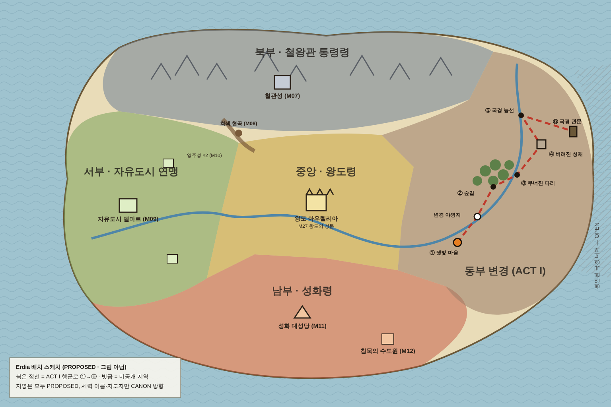

# 세계 지도와 막간 거점 — 큰 그림 (v0.5.0, Phase F 이전)

상태: **APPROVED_DIRECTION** — 사용자가 W1–W4를 모두 권장안으로 승인 (2026-10-20, D-052). 지명·거점 연출은 여전히 PROPOSED 수준의 세부이며, 이름은 언제든 바꿀 수 있다.
- 그림 지시서: [ART_BRIEF_WORLD](ART_BRIEF_WORLD.md)
- 배치 스케치: [art/world_layout_sketch.png](art/world_layout_sketch.png)

> 사용자 요청 (2026-10-20):
> 1. 첫 시작에 전체 지도를 보여 주고 지역별로 나눈다. 조조전 지도처럼 성이 있고, 어느 지역의 이야기인지 보여 준다.
> 2. 미션 사이의 거점은 상황마다 달라야 한다. 야영이면 방랑 상인이 도구·무기를 팔고, 장수들은 모닥불 곁에, 주변엔 텐트.
> 3. 이 내용을 바탕으로 ChatGPT에 그림을 요청한다.

## 0. 지키는 것과 바꾸는 것

| 구분 | 내용 |
|---|---|
| **CANON / APPROVED_DIRECTION (그대로)** | 대륙 Erdia, Aurelius의 200년 통일. 세 세력과 지도자: Iron Crown Dominion·철왕관 (Cassian), Free Lords Alliance (Leonora), Order of the Sacred Flame·성화 교단 (Lucien). ACT I 장소 순서: 잿빛 마을 → 숲길 → 무너진 다리 → 버려진 성채 → 국경 능선 → 국경 관문. ACT II~IV 미션 제목 |
| **PROPOSED (이 문서에서 새로 제안)** | 지역 배치(동서남북), 한글 지역명(철왕관 통령령, 자유도시 연맹, 성화령), 지명(아우렐리아, 철관성, 벨마르 등), 막간 거점의 종류와 배치, 성채를 군단 거점으로 쓰는 연출, 군단 깃발 모양 |
| **바꾸지 않음** | 미션 규칙, 대사, 보상, 경제(상점 품목과 가격), M01–M03 EXP, ACT I 30 seed 결과. **거점의 겉모습이 달라져도 상점 목록은 같다.** 방랑 상인도 같은 품목을 판다 |
| **OPEN (정하지 않음)** | 봉인된 국경 너머에 무엇이 있는가, 왕관의 작동 원리, 재상의 책임 |

## 1. 현재 진단 (v0.5.0 브랜치)
- 거점이 두 개뿐이다: `village`(M01)와 `camp`(M02–M06).
  - `frontier.js enterHub`가 `missionId===1 ? 'village' : 'camp'`로 고른다.
  - 그래서 숲 추격, 다리 구조, 성채, 능선, 관문 앞이 모두 같은 장소다.
- '변경 야영지'가 야영지로 보이지 않는다. 절차 생성 픽셀 지형 위에 목조 주택이 격자로 놓여 있어 마을과 같은 모양이다.
- 여정의 감각이 없다. 지금 대륙 어디에 있고, 어디서 어디로 가는지 알 수 없다.
- 반신과 맵 스프라이트는 손그림으로 바뀌었는데, 거점 바닥은 아직 절차 생성 타일이다.

## 2. 세계 지도

### 2.1 Erdia 배치 (PROPOSED)

| 지역 | 지명 (PROPOSED) | 세력 (CANON) | 지형 성격 | 이야기 | 지도 공개 |
|---|---|---|---|---|---|
| 동부 | **동부 변경** (Eastern March) | 왕국 국경 수비대 → 재의 맹세 군단 | 잿빛 침엽수림, 강 협곡, 구릉, 동쪽 끝 관문 | ACT I 전체 (M01–M06) | 처음부터 |
| 중앙 | **왕도령**, 왕도 **아우렐리아** | 왕실 (군령부) | 황금빛 농지, 큰 강, 성벽 도시 | 명령서의 출처, M27 왕도의 성문 | 윤곽은 처음부터, 이름은 M06 명령서 이후 |
| 북부 | **철왕관 통령령**, 거성 **철관성**, **회색 협곡** | Iron Crown Dominion (Cassian) | 눈 덮인 산맥, 검은 소나무, 석조 요새 | M05 발드릭의 깃발, M07–08 | M05 이후 |
| 서부 | **자유도시 연맹**, 자유도시 **벨마르**, 영주성 두 곳 | Free Lords Alliance (Leonora) | 초록 평원, 강 하구 항구, 풍차 | M09–10 | ACT II |
| 남부 | **성화령**, **성화 대성당**, **침묵의 수도원** | Order of the Sacred Flame (Lucien) | 붉은 절벽, 고원, 햇빛에 그은 땅 | M11–12 | ACT II |
| 동쪽 끝 | 봉인된 국경 너머 | **OPEN** | 안개 | 정하지 않음 | 안개로만 표시 |

**배치 이유**
- M05에서 발드릭의 깃발이 '북쪽 능선'에 오르므로 동부 변경의 북쪽이 철왕관 영토와 맞닿는다.
- 명령서는 왕실 군령부에서 오므로 왕도는 서쪽 내륙(지도 중앙)에 둔다.
- 행군로 ①→⑥은 남서(마을)에서 북동(관문)으로 올라간다. ACT I이 끝날 때 군단은 왕도에서 가장 먼 곳에 서 있다.

### 2.2 화면 구성 (조조전식, 내용은 독자)

| 층 | 무엇 | 만드는 쪽 |
|---|---|---|
| 1 | 양피지 위 채색 지도 (지형만, 글자 없음) | ChatGPT 그림 `world_map` |
| 2 | 세력 색 영역 (반투명, 공개된 지역만) | 게임 (다각형 데이터, 그림 도착 후 Claude가 지형에 맞춰 그림) |
| 3 | 성·도시·마을·야영 아이콘 | ChatGPT 아이콘 시트 `world_icons`, 위치는 게임 데이터 |
| 4 | 한글 지명, 행군로 점선, 현재 위치 깃발, 전장 표시(⚔) | 게임 |
| 5 | 지역 이야기 카드: "ACT I · 불타는 국경 — 동부 변경, 잿빛 마을" | 게임 |

지명을 그림에 넣지 않는 이유가 두 가지 있다. 한글 글꼴을 게임과 맞출 수 있고, 지명이 바뀌어도 그림을 다시 받지 않아도 된다.

### 2.3 언제 나오나

1. **새 게임 시작 (한 번)**
   - 대륙 전경을 2초 보여 준다.
   - 내레이션은 APPROVED_DIRECTION 문장만 쓴다. 예: "에르디아. 이백 년 전, 한 왕관 아래 하나가 된 땅."
   - 동부 변경으로 카메라를 당긴다 → 지역 카드 → 잿빛 마을 아침 (기존 `pre:1`).
2. **장소가 바뀔 때마다**
   - 흐름: 전투 결과 → 지도 → 행군선 애니메이션(현재 거점 → 다음 거점) → 거점 카드("강가 야영 — 무너진 다리에서 하룻길") → 거점 도착.
   - 같은 장소에 머물면 지도를 건너뛴다.
3. **언제든 보기**: 메뉴의 '세계 지도'는 읽기 전용으로 열린다.
   - 기존 '지도' 버튼(거점 안 빠른 이동)은 '거점 지도'로 이름을 바꿔 구분한다.
4. 모든 지도 연출은 탭 한 번으로 넘길 수 있다. 모바일 390 세로에서는 지도를 화면 폭에 맞추고, 확대와 이동을 지원한다.

## 3. 막간 거점 유형

모든 거점에 **무기, 도구, 작전 회의(출진)**는 반드시 있다. 경제를 그대로 두기 위해서다. 겉모습과 상점 형태만 상황에 맞게 바꾼다.

| 유형 id | 상황 | 시간·분위기 | 필수 시설 (게임 기능) | 장수·NPC 연출 | 상점 형태 |
|---|---|---|---|---|---|
| `village` | 평시 마을 | 아침, 맑음 | 대장간(무기), 도구점, 여관, 촌장 집, 작전실 | 장수들이 마을 일을 돕는다 (기존) | 건물 안 상점 (기존 실내) |
| `village_raid` | 습격 직후 마을 | 해 질 녘, 연기 | 같은 배치 + 불탄 집, 잔해, 임시 구호소 | 세인이 부상자 곁에, 리아가 상자 앞에 | 반쯤 그을린 건물, 실내 그대로 |
| `garrison` | 국경 수비대 진영 (지금의 Border Camp를 다시 그림) | 낮, 흐림 | 지휘 천막, 보급관 천막(도구), 노천 야전 대장간(무기), 구호 천막, 망루, 목책 | 정규군 보초, 훈련하는 병사, 아렌은 지휘 천막 | 천막 앞 계산대, 실내 없음 |
| `bivouac` | 행군 중 야영 | **밤**, 모닥불 | **모닥불(중앙)**, 텐트 3–4, **방랑 상인 마차(도구+무기 겸업)**, 지휘 천막(지도 탁자), 말과 짐수레, 보초 | **장수들이 모닥불 둘레에 앉거나 선다.** 상인이 마차 앞 등불 아래에서 물건을 펼친다 | 마차 앞 노천 거래 |
| `fortress` | 탈환한 버려진 성채를 임시 거점으로 씀 | 낮, 바람 | 석조 안뜰, 무기고(무기), 창고(도구), 기록실, 성벽 계단·망루, 수리 중인 문 | 리아가 기록실에, 에릭이 성벽 위에, 카이가 뒷문에 | 무기고·창고 문 앞 |
| `oathcamp` | 재의 맹세 이후 재의 군단 진영 (관문 바로 너머, M06 전장의 북쪽 안전 지대) | 해 질 녘 → 밤 | 새 군단 깃발, 훈련장(**군단 훈련**), 맹세의 화톳불(**전직 의식**), 텐트 다수, 방랑 상인 합류, 지휘 천막 | 다섯 장수가 깃발 아래 모인다. v0.5 전직 의식의 무대 | 방랑 상인 마차 + 야전 대장간 |

ACT II 이후 후보 (PROPOSED, 이번에는 그리지 않음):
- `castle_town` 성하 마을 (철관성 아래)
- `free_market` 자유도시 시장 (벨마르, 상점 여럿)
- `monastery` 수도원 회랑
- `march_camp` 대규모 군단 행군 진영

## 4. ACT I 거점 배치

| 시점 (story key) | 지금 | 제안 거점 | 지도 위치 | 근거 |
|---|---|---|---|---|
| `pre:1` | village | `village` | ① 잿빛 마을 | 습격 전 아침 |
| `after:1` | village (불탄 집 표시) | `village_raid` | ① | "불탄 집보다 돌아온 얼굴부터 세겠네" |
| `pre:2` | camp | `garrison` | 변경 야영지 | 정찰 보고를 수비대 진영에서 받는다 (PRE_BATTLE_SCENES) |
| `after:2` / `pre:3` | camp | `garrison` | 변경 야영지 | "같은 야영지에서 다음 구조 작전을 준비한다" — 대사와 일치 |
| `after:3` | camp | **`bivouac`** (강가) | ③ 다리 너머 | "지금은 쉬자"와 아렌의 잿빛 밤 회상을 모닥불 장면으로 |
| `pre:4` | camp | **`bivouac`** (성채 앞 숲) | ④ 근처 | 성채로 가는 행군 중 |
| `after:4` / `pre:5` / `after:5` / `pre:6` | camp | **`fortress`** | ④ 버려진 성채 | 장부를 손에 넣은 성채를 거점으로 쓴다 (PROPOSED 연출, 새 사실 없음) |
| `6:oath` 이후, 전직 의식·시련·군단 훈련 | camp | **`oathcamp`** | ⑥ 관문 바로 너머 | M06 승리 후 군단이 관문 너머 안전 지대로 철수한다 (MISSION_06 지도). 관문은 배경에 보인다 |

이 배치로 ACT I 거점은 2곳에서 **6곳**(마을 2변형 + 진영 + 야영 + 성채 + 맹세 진영)으로 늘고, 지도 이동 연출은 5번 나온다.
- 기존 대사에서 장소를 직접 가리키는 문장을 찾아봤다 (`grep 야영|진영|모닥불|천막`). 위 배치와 어긋나는 문장은 없다.

## 5. 게임에 넣는 방법 (기술 요약)

- **그림 한 장 = 거점 하나.**
  - 1536×1024 = 24×16칸 × 64px. 지금 HD 지형과 칸 크기가 같아 스프라이트 크기를 그대로 쓴다.
  - 그림이 도착하면 Claude가 그 위에 다음 데이터를 손으로 작성한다: 걸을 수 있는 칸, 문과 시설 칸, NPC 자리.
  - 그림이 칸에 정확히 맞지 않아도 되도록, 지시서는 '넓은 길, 열린 광장'만 요구한다.
- **데이터**
  - `HUBS`에 `kind`, `art`, `site`, `walk` 마스크를 더한다.
  - `hubFor(missionId, phase, campaign)` 표가 `missionId===1?…` 분기를 대신한다.
  - 새 파일 `src/data/world.js`: 지역, 거점·전장 위치, 행군로, 공개 조건.
  - 새 파일 `src/ui/world-map.js`: 지도 화면.
- **밤 연출**: 모닥불 일렁임과 등불 빛은 게임이 그린다. 지금의 `drawFire`를 재사용하고 빛 오버레이를 더한다.
- **저장**
  - schema 8을 그대로 쓴다 (v0.5.0은 아직 미출시).
  - 7→8 마이그레이션에서 `frontier.hub`를 새 배치표로 옮기고, 새 거점의 `visited`를 채운다.
  - 지도 상태는 저장하지 않고 캠페인 진행에서 계산한다. 예외는 첫 지도를 봤는지 여부(`seenWorldIntro`) 하나뿐이다.
- **그림이 오기 전**: 유형별 임시 배치(텐트, 모닥불, 마차)를 절차 생성으로 먼저 만든다. 흐름과 테스트를 진행하되 '완성'이라고 표시하지 않는다.
- **용량**: WebP 8장, 장당 약 250–400KB → HTML이 약 2.5MB 늘어 약 14.5MB가 된다.
- **검증 계획**
  - unit: 모든 ACT I 시점이 무기·도구·출진을 가진 거점으로 이어지는지, 7→8 마이그레이션의 거점 이동.
  - 브라우저: 새 게임 → 지도 → 카드 → 마을 (1440 / 390 / 844 가로), 장소 이동 지도 넘기기, 야영 상인 거래.
  - act1-balance 30 seed 결과 불변.

## 6. 진행 순서

| 단계 | 내용 | 누가 |
|---|---|---|
| E2-a | 이 문서 승인: 지명, 배치, 거점 유형, 공개 방식 — **완료 2026-10-20** | 사용자 |
| E2-b | ChatGPT 그림 8장 ([ART_BRIEF_WORLD](ART_BRIEF_WORLD.md)) | 사용자 (E2-c와 동시에) |
| E2-c | 지도 화면, 거점 유형, 배치표, 임시 그림, 마이그레이션, 테스트 | Claude |
| E2-d | 그림 import, 걷기 마스크·세력 다각형 작성, 스크린샷 검증 | Claude |
| F | 연출과 마무리 (기존 계획) | Claude |

## 7. 승인 질문 (2026-10-20 모두 권장안으로 승인)

| # | 질문 | 권장 |
|---|---|---|
| W1 | 지역 배치와 지명 (§2.1) | 제안대로. 이름은 언제든 바꿀 수 있다 (그림에 글자가 없으므로) |
| W2 | 세력 영역 공개: 처음부터 전부 vs 이야기에서 만난 뒤 | 윤곽과 지형은 처음부터, 세력 색과 이름은 만난 뒤 |
| W3 | ACT I 거점 6종과 배치 (§3, §4) | 제안대로 |
| W4 | 지도 연출 빈도: 새 게임 + 장소가 바뀔 때 vs 미션마다 | 새 게임 + 장소가 바뀔 때 |

## 8. 구현 상태 (2026-10-20)

| 항목 | 상태 |
|---|---|
| 아트 팩 수신 | 1차 ZIP이 업로드 중 25.19MB에서 잘려 거점 4장만 수신(SHA256 일치). 나머지 4장은 Part 2 팩으로 다시 받음: GPT가 예전 결과물을 재포장(Path A), 4장 모두 1차 manifest의 SHA256과 일치. 8장 모두 `scripts/import-world-art.py`로 WebP 변환 (`src/assets/world-art-import-log.csv`) |
| 거점 (§3–4) | 6곳 모두 그림 + 걷기 마스크로 구현 (`src/data/hubs-v05.js`). 마을은 평시(M01 전)와 습격 후(M01 후) 두 그림이 같은 배치를 쓰며, 무기점·도구점은 v0.3.3과 같은 문 앞 확인 → 상점 내부 흐름을 유지 |
| 세계 지도 (§2) | 새 게임 소개, 장소 이동 시 행군 지도, 메뉴 '세계 지도' 구현 (`src/data/world.js`, `src/render/world-renderer.js`, `src/data/story-world.js`). 그려진 지도와 아이콘 9종 적용, 장소 좌표를 그림의 강·협곡·평지에 맞춤 (왕도는 강 북쪽 평원, 무너진 다리는 협곡 위) |
| 세부 결정 | D-053 (PROPOSED) |
| 검증 | `tests/hubs.test.mjs`, `test:world` (1440 / 390), 기존 browser suite 갱신 (journey: 진영 상점은 노천 판매대) |

